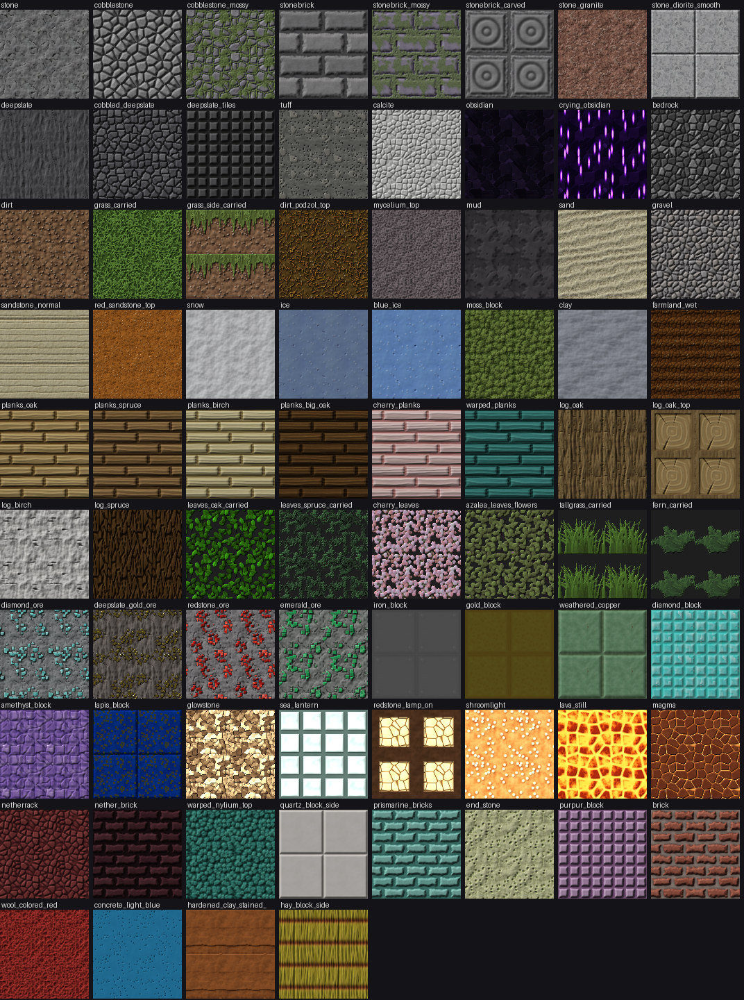

# Halcyon Vibrant Visuals

A physically based "shader" pack for **Minecraft: Bedrock Edition**, delivered as a
`.mcaddon`. It drives Bedrock's built-in Vibrant Visuals renderer (deferred PBR
lighting, real-time shadows, screen-space reflections, volumetric fog and light
shafts, water waves and caustics) with a full set of hand-tuned settings, and
replaces 374 block textures with procedurally generated 64x PBR texture sets.



> **Why no GLSL/HLSL?** Since the RenderDragon engine, Bedrock no longer loads
> custom shader code from resource packs. Vibrant Visuals is the supported way
> for a pack to change how the game renders: the pack provides materials
> (colour, normal, metalness/emissive/roughness/subsurface maps) and lighting
> data (sun, sky, fog, water, colour grading, lights), and the engine's shaders
> do the rest. Everything below is that data.

## Install

1. Open `dist/Halcyon-Vibrant-Visuals.mcaddon` on the device that runs Minecraft
   (double-click on Windows; "Open with Minecraft" on mobile). Minecraft imports it.
2. **Settings → Global Resources** → activate **Halcyon Vibrant Visuals** and move it to the top.
3. **Settings → Video → Graphics Mode → Vibrant Visuals.**

Requires Bedrock **1.26.0 or newer** on a device that supports Vibrant Visuals.
Running the build (below) also writes a `.mcpack` of the same pack to `dist/`.

## What's in it

### Materials (374 texture sets, 64x)
Every texture ships three layers: colour, a **normal map** (DirectX/Y− convention,
matching Mojang's own) and a **MERS** map (metalness, emissive, roughness, subsurface).

| Family | Highlights |
| --- | --- |
| Stone, deepslate, tuff, calcite, basalt, blackstone, obsidian | domain-warped rock, hairline cracks, polished variants smooth enough (roughness < 0.3) to get screen-space reflections |
| Ores (stone, deepslate, nether) | compact mineral veins; gold/copper inclusions are true metals; diamond/emerald are faceted gems that glint; redstone ore glows faintly |
| Dirt, grass, podzol, mycelium, mud, clay, farmland, path | stamped grass blades, soil clods and pebbles; mud has wet, reflective puddles |
| Sand, gravel, sandstone | wind ripples, quartz glints that sparkle in sunlight, stratified sandstone |
| Snow, powder snow, ice, packed/blue ice | subsurface-scattering snow, glassy cracked ice |
| 12 wood species | staggered planks with cupped boards and grain; bark per species (furrowed oak, scaly spruce, lenticel birch/cherry); ringed log ends; stripped logs |
| Leaves (10 species), tall grass, ferns | alpha-cut leaf canopies and blades with **strong subsurface scattering** so foliage glows when backlit; opaque and inventory variants |
| Metal blocks | brushed iron, hammered gold, netherite, four copper oxidation stages where patina takes over metalness, cut copper |
| Gem and mineral blocks | diamond, emerald, amethyst, lapis (with metallic pyrite flecks), redstone, coal |
| Emissives | glowstone, animated sea lantern, redstone lamp, shroomlight, froglights, animated magma |
| Fluids | 32-frame looping water ripples (integer wavevectors, so they tile and loop seamlessly), flowing water, convecting lava, flowing lava |
| Dyed blocks | wool, concrete, concrete powder, terracotta, stained glass and panes in all 16 colours |
| Nether and End | netherrack, nether bricks, wart blocks, nylium, soul sand/soil, ancient debris, end stone, purpur |

Every texture is tone-matched to the vanilla texture it replaces (see
`vanilla_data/block_stats.json`), so biome tints, map colours and the overall
look of the world stay familiar.

### Lighting and atmosphere
* **Sun and moon**: day/night illuminance and colour keyframes with a golden hour,
  red sunsets and a cool blue moonlight; the sun's path is tilted 18° so shadows
  rake across the terrain instead of running along the block grid.
* **Sky**: Rayleigh/Mie scattering curves, sunset glare and horizon colours for 26 profiles.
* **Shadows**: soft shadows.
* **Colour grading**: ACES filmic tone mapping, split-toning (warm highlights,
  cool shadows) and per-biome white balance.
* **Volumetric fog and light shafts**: height-based fog that pools in valleys and
  thins with altitude, thicker in swamps, jungles, dark forests and the pale garden,
  denser during rain; separate underwater volumetrics; every Nether biome has its own haze.
* **Water**: waves on, physically based colour from particle concentrations for 16
  water types (tropical, deep ocean, frozen, swamp, mangrove, river, lush cave, ...),
  and a custom **photon-traced caustics** sprite sheet.
* **Block lights**: colour temperatures for torches, lanterns, soul fire, candles,
  copper lights (dynamic point lights with shadows) plus static light colours for
  glowstone, sea lanterns, lava, froglights, crying obsidian and more.
* **PBR fallbacks** for mobs, items and particles without texture sets.

All 89 vanilla biomes are wired to one of 26 lighting/sky/grading profiles, one
of 16 water types and their own fog.

## Building it yourself

```bash
pip install numpy pillow
python build.py            # 64x  -> dist/Halcyon-Vibrant-Visuals.mcaddon (~9 MB)
python build.py --res 128  # sharper textures, ~4x the size
```

The build renders every texture, writes the Vibrant Visuals JSON, validates the
result against the engine's texture-set and biome rules (`tools/validate.py`)
and zips the pack. It takes about 15 seconds.

| Path | What it is |
| --- | --- |
| `halcyon/noise.py` | tileable Perlin, value, ridged and Worley noise |
| `halcyon/pbr.py` | material container, normal-map generation, AO, tone calibration, writers |
| `halcyon/lib.py` | shared patterns: bricks, pebbles, wood grain, stamped blades and leaves |
| `halcyon/materials/*.py` | one recipe per texture family |
| `halcyon/config/vv.py` | sun, sky, grading, water, fog, light colours and the biome mapping |
| `vanilla_data/` | vanilla client-biome and fog files, plus colour statistics (refresh with `tools/sync_vanilla.py`) |
| `tools/validate.py`, `tools/gallery.py` | build checks and the gallery above |

To tweak the look, edit the curves and `PROFILES` in `halcyon/config/vv.py`
(time keys: 0.0 noon, 0.25 sunset, 0.5 midnight, 0.75 sunrise) and rebuild.

## Limitations

* Blocks with drawn artwork (furnaces, doors, chests, crafting tables, flowers,
  ...) keep their vanilla textures and vanilla PBR maps, so they look slightly
  flatter than the 64x blocks around them.
* Crimson and warped stem sides are animated in vanilla and are left as vanilla.
* Vibrant Visuals does not allow screen-space reflections on glass, and only
  surfaces with roughness below about 0.4 receive them.
* The pack was checked against Mojang's published schemas and vanilla data but
  has not been play-tested on every device; if something looks off, tune the
  values in `halcyon/config/vv.py`.
